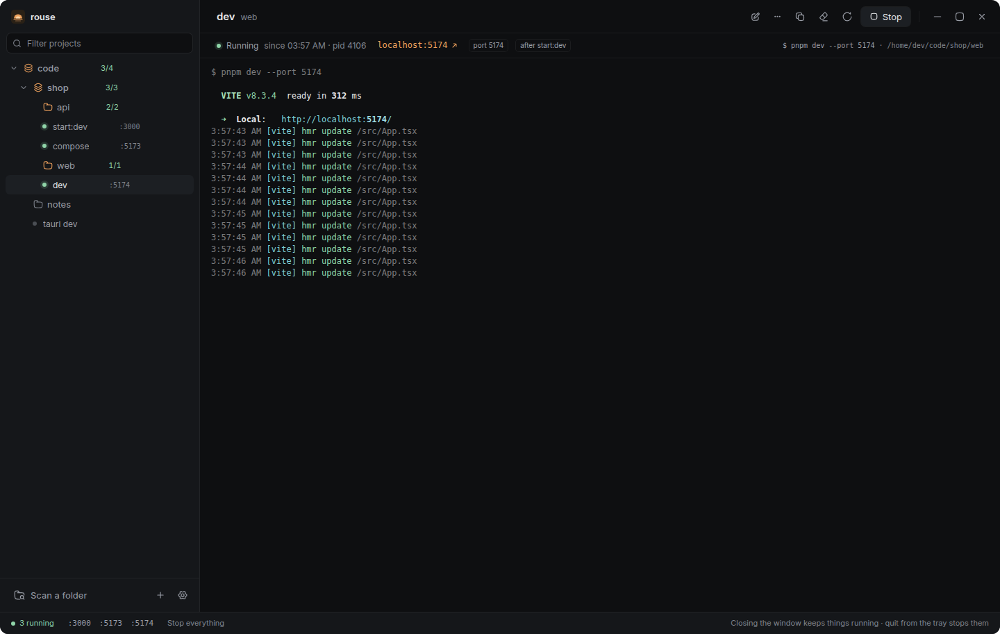
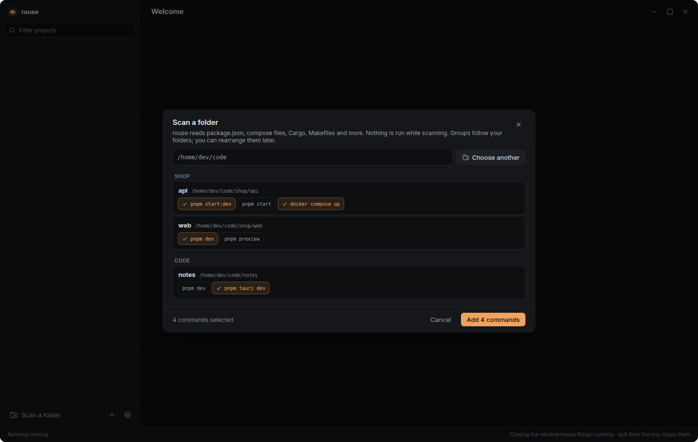
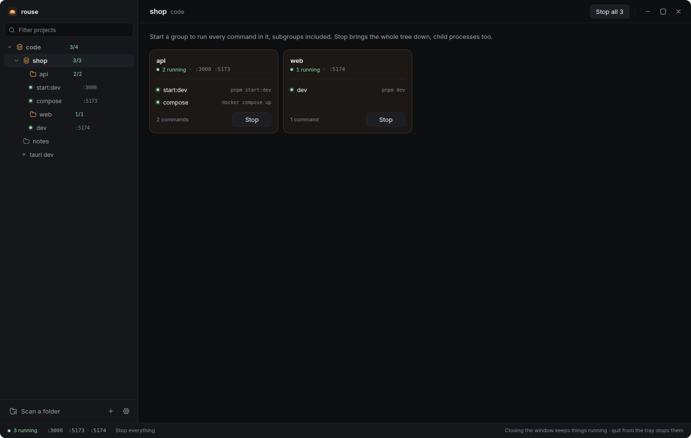
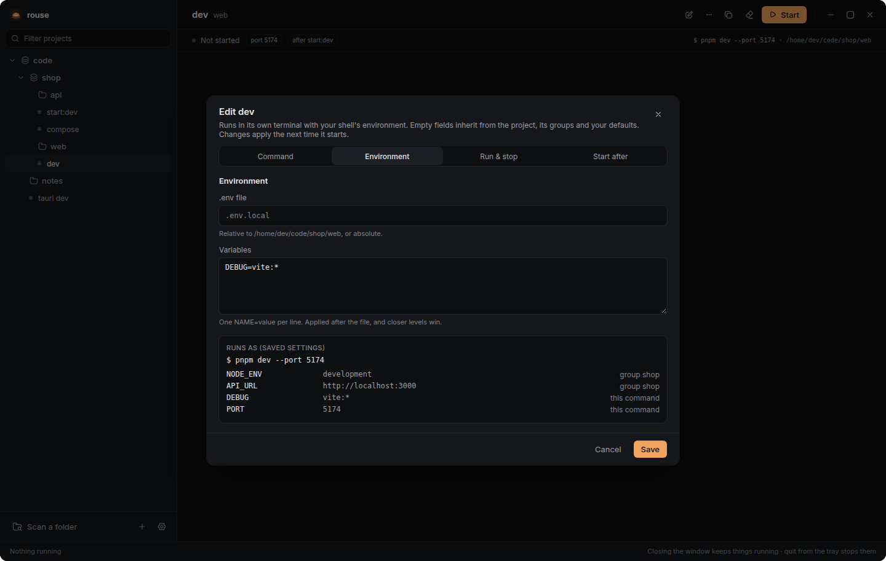

# rouse

Wake your dev stack. rouse remembers the commands that start your projects, so the next time you need them they're one click away, grouped the way your folders are.

Muffle quiets things down; rouse wakes them up. Same family as [GitSwitch](https://github.com/iput-object/GitSwitch) and [muffle](https://github.com/iput-object/muffle): Tauri 2, Rust, React, one accent colour.



## Install

Download the `.deb` from [Releases](https://github.com/iput-object/rouse/releases) and install it:

```sh
sudo apt install ./rouse_0.1.0_amd64.deb
```

Linux only for now (Tauri 2, WebKitGTK).

## How it works

1. **Scan a folder.** rouse reads `package.json` scripts (with the right package manager from your lockfile), compose files, `Cargo.toml`, Makefiles, `go.mod` and `manage.py`. Nothing in a repo is run while scanning. `node_modules`, `target`, build output and dot-folders are skipped, and symlinks are not followed.
2. **Tick what you use.** The usual dev command is pre-ticked (`start:dev` for Nest, `tauri dev` for Tauri apps, `dev` elsewhere). Groups follow your folders: `code/shop/api` lands in **code › shop**.
3. **Start anything.** A command, a project, or a whole group (subgroups included) starts from the tree. Each command runs in its own terminal, so colours, watch modes and prompts work. Detected ports show as links.

Rescanning only adds what's new. It never duplicates a project or undoes a rename, a move or an edited command.

| Scan a folder | A group running |
| --- | --- |
|  |  |

## Overrides

Settings cascade: **defaults (gear) → group → subgroup → … → project → command**. The closest level that sets something wins, and the command editor shows every value with where it came from ("SIGINT, from group shop").

| Setting | Levels | What it does |
| --- | --- | --- |
| Variables and a `.env` file | all | Each level's file is read, then its own variables; closer levels win. Relative files resolve against each project's folder, so `.env.local` on a group means every project's own file. |
| Port | command | Sets `PORT`, and adds the tool's own flag when the package.json script runs vite, astro, nuxt or webpack serve (`--port`), or next or storybook (`-p`). Before starting, rouse checks the port is free and asks before starting anyway. |
| Shell | all | Runs the command as `<shell> -c "…"`. Default `/bin/sh`. |
| Stop signal, grace period | all | SIGTERM, SIGINT or SIGHUP to the whole process tree, then SIGKILL after the grace period (default 5 s). |
| Auto-restart | all | Restarts after a crash with 1, 2, 4… s between tries (at most 30 s), and gives up after 5 crashes in 2 minutes. A clean exit is never restarted; Stop cancels a pending restart. The crash stays on screen above the new run. |
| Start after | command | Starting the command first starts these (if needed) and waits until each is ready: its port answers, or it has run 3 s if it has no port. Loops are refused. Group starts follow the same order. |



**Start with…** runs a command once with extra arguments and variables (they win over every override), or saves that as a new command that keeps the original's overrides.

Limits worth knowing:

- `.env` files: `KEY=value`, `export`, quotes and `#` comments; no `${VAR}` expansion and no multi-line values.
- A dependency already running outside rouse counts as ready when its port is set and answers (your own Postgres on 5432).
- Ctrl-C typed into the terminal never triggers an auto-restart.
- A saved variant keeps the original's port, so it asks before starting while the original runs.
- Restart re-runs the saved command; one-off arguments are for that single run.

## Stopping

- **Stop** sends the stop signal (SIGTERM unless overridden) to the command's whole process group (`pnpm` → `node` → `esbuild` together), then SIGKILL after the grace period (5 s unless overridden).
- Closing the window hides it to the tray; your services keep running.
- **Quit** from the tray stops everything first, and so does SIGTERM at logout.
- If rouse crashes, the next launch stops what it left running (checked by start time, so a reused PID is never touched).

## The environment

Started from the app menu, a desktop app doesn't get what your shell rc files add (nvm, pnpm, cargo). rouse asks your login shell for its environment once at startup (8 second timeout) and runs every command with it. Variables, a .env file and the shell can be overridden per level (see Overrides).

## Develop

```sh
pnpm install
pnpm tauri dev          # the app, with hot reload
cd src-tauri && cargo test --lib   # process manager, overrides, dependencies, scanner, store, crash cleanup
```

Slow or machine-specific checks are ignored by default:

```sh
# Scan a real folder and print what would be offered
ROUSE_SCAN=~/code cargo test --lib scan_real -- --ignored --nocapture
# Scan, import, start a whole group with the real environment, stop it, check ports are free
ROUSE_ACCEPT=~/code/shop cargo test --lib acceptance -- --ignored --nocapture
```

Build a package: `pnpm tauri build --bundles deb` (or `appimage`).

Data lives in `~/.local/share/com.iput-object.rouse/rouse.db`.

## License

GPL-3.0-only
